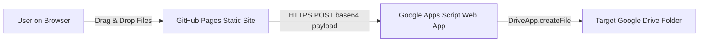

# 🚀 DriveDrop — Complete Setup & Deployment Guide

This guide explains how to connect your **Google Drive Folder** to your **GitHub Pages** website using a free Google Apps Script serverless proxy.

---

## 🎯 Architecture Overview



- **Frontend**: Pure HTML5/CSS/JavaScript running on GitHub Pages (zero hosting costs).
- **Backend**: Google Apps Script Web App executing under your Google account (free, zero-maintenance).
- **Target Google Drive Folder**: Pre-configured folder ID `1pS3g7wmOS0ZjxPx61zy3lOjLNDG2AACz`.

---

## Step 1: Deploy the Google Apps Script Backend (2 Minutes)

1. Open your browser and go to **[script.new](https://script.new)**.
   *(Make sure you are logged into the Google account that has access to the target Google Drive folder)*.
2. Delete any boilerplate code inside `Code.gs`.
3. Copy the entire contents of [`google-apps-script/Code.gs`](google-apps-script/Code.gs) and paste it into the editor:
   ```javascript
   const TARGET_FOLDER_ID = "1pS3g7wmOS0ZjxPx61zy3lOjLNDG2AACz";

   function doGet(e) {
     return ContentService.createTextOutput(JSON.stringify({
       status: "online",
       folderId: TARGET_FOLDER_ID
     })).setMimeType(ContentService.MimeType.JSON);
   }

   function doPost(e) {
     try {
       var payload = JSON.parse(e.postData.contents);
       var decodedBytes = Utilities.base64Decode(payload.fileData);
       var blob = Utilities.newBlob(decodedBytes, payload.mimeType || "application/octet-stream", payload.filename);
       var folder = DriveApp.getFolderById(TARGET_FOLDER_ID);
       var file = folder.createFile(blob);
       file.setDescription("Uploaded via Web Portal on " + new Date().toLocaleString());
       
       return ContentService.createTextOutput(JSON.stringify({
         status: "success",
         fileUrl: file.getUrl(),
         fileName: file.getName()
       })).setMimeType(ContentService.MimeType.JSON);
     } catch (err) {
       return ContentService.createTextOutput(JSON.stringify({
         status: "error",
         message: err.toString()
       })).setMimeType(ContentService.MimeType.JSON);
     }
   }
   ```
4. Click **Deploy** (top right blue button) &rarr; **New deployment**.
5. Click the gear icon next to "Select type" and choose **Web app**.
6. Set the configuration:
   - **Description**: `Media Uploader to Google Drive`
   - **Execute as**: `Me (your-email@gmail.com)`
   - **Who has access**: `Anyone` *(⚠️ Crucial: This enables cross-origin uploads from your GitHub Pages website without requiring uploaders to log into Google)*
7. Click **Deploy**.
8. Click **Authorize access**, choose your Google account, and grant the Drive permission.
9. Copy your generated **Web App URL** (it looks like `https://script.google.com/macros/s/.../exec`).

---

## Step 2: Configure the Frontend

You can configure your Web App URL in either of two ways:

### Option A: Via the Web Interface (Saved in Browser)
1. Open the website.
2. Click the **⚙️ Settings** icon in the top right.
3. Paste your Web App URL and click **Test Connection** &rarr; **Save Changes**.

### Option B: Permanently in `js/config.js` (Recommended for GitHub Pages)
Open [`js/config.js`](js/config.js) and set `APPS_SCRIPT_URL`:
```javascript
APPS_SCRIPT_URL: "https://script.google.com/macros/s/YOUR_DEPLOYED_URL_HERE/exec",
```

---

## Step 3: Host on GitHub Pages (1 Minute)

1. Initialize Git and commit your files:
   ```bash
   git init
   git add .
   git commit -m "Initial commit for DriveDrop"
   ```
2. Create a new repository on [GitHub](https://github.com/new) (e.g., `media-uploader`).
3. Push your repository:
   ```bash
   git remote add origin https://github.com/YOUR_USERNAME/media-uploader.git
   git branch -M main
   git push -u origin main
   ```
4. On GitHub, go to your repository **Settings** &rarr; **Pages** (in left sidebar).
5. Under **Build and deployment** &rarr; **Source**, select **Deploy from a branch**.
6. Select branch `main` and folder `/ (root)`, then click **Save**.
7. In about 30 seconds, your site is live at:
   `https://YOUR_USERNAME.github.io/media-uploader/`

---

## 💡 Important Tips for Robustness

- **File Size Recommendations**:
  Google Apps Script has an execution memory payload limit of ~50MB per POST request. For photos, graphics, and short to medium videos (<45 MB), uploads work quickly and reliably.
- **Redeployment Rule**:
  If you ever update the code inside `Code.gs` in Google Apps Script, you **must** click **Deploy &rarr; Manage deployments &rarr; Edit &rarr; New version &rarr; Deploy** to apply changes to the live URL.
